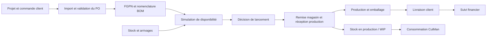

# Modules à présenter — Soutenance de stage

**Projet : gestion des lancements industriels Adient**
**Auteur du projet : Wassim Mchichi**
**Document préparé le : 28 octobre 2026**
**Usage : préparer les diapositives, le discours et la démonstration.**

**Complément issu d’Adient.zip :** consulter [la documentation et le prompt d’ajout à la présentation](PROMPT_AJOUT_ADIENT_PRESENTATION.md). Ce complément couvre le cahier des charges, les réunions/PV, les collaborateurs, les notifications et l’audit des accès dans une troisième version technique.

## 1. Fil conducteur de la présentation

**Problématique proposée : comment transformer une commande client en un lancement de production réalisable, en tenant compte des nomenclatures, du stock et de la traçabilité ?**

Présenter le projet comme un parcours métier. Les écrans et les technologies servent à expliquer ce parcours :

Les droits d’accès, les documents et l’audit accompagnent l’ensemble du parcours. Ce schéma représente le périmètre fonctionnel ; il ne certifie pas que toutes les étapes sont reliées dans chaque version.

## 2. Périmètre des sources et versions

Les sources fournies décrivent **deux implémentations différentes**. Pour la soutenance, annoncer la version démontrée et conserver son vocabulaire pendant toute la démonstration.

| Point | Projet local `po` | Archive `Launch-System.zip` |
| --- | --- | --- |
| Backend | FastAPI, SQLAlchemy, migrations Alembic | Spring Boot, JPA, migrations Flyway |
| Interface | React, TypeScript, TanStack Router/Start | React, TypeScript, React Router |
| Simulation | Aperçu backend et sauvegarde des simulations et allocations | Calcul backend sans enregistrement d’une simulation ; transmission possible vers le parcours de lancement |
| Identité | Session de démonstration et en-têtes de rôle | Authentification JWT, comptes et changement de mot de passe documentés |
| Exécution industrielle | Chaîne lancement/remise/livraison encore partiellement reliée | Modules de lancement, magasin, production et emballage présents dans l’archive |
| Finance et audit | Certaines vues restent des démonstrations | Contrôleurs et modules dédiés présents dans l’archive ; validation en exécution à effectuer |

Les quatre documents locaux datent du **22 octobre 2026**. Les raccordements réalisés ensuite dans ce chat concernent notamment le stock, CutMan, les unités/types issus du BOM et la sauvegarde des simulations. Leurs descriptions anciennes ne doivent donc pas être reprises comme un état exact de ces écrans.

L’archive contient aussi des divergences internes : son index indique encore que finance, livraison client et audit métier ne sont pas implémentés, alors que des modules et contrôleurs correspondants sont présents. Leur présence est établie par lecture ; leur fonctionnement complet n’a pas été testé ici.

## 3. Modules à représenter dans le support

| Ordre | Module fonctionnel | Priorité pour la soutenance | Message à faire passer |
| --- | --- | --- | --- |
| 1 | Utilisateurs, rôles et administration | Synthèse | Chaque acteur intervient dans son périmètre. |
| 2 | Projets et affectations | Essentiel | Le projet structure les commandes et les responsabilités. |
| 3 | Commandes clients — PO | Essentiel | Les documents clients deviennent des données contrôlées et versionnées. |
| 4 | Nomenclatures — BOM / MBOM | Essentiel | Les besoins matière sont calculés à partir des produits finis. |
| 5 | Stock, réception, transit et seuils | Essentiel | La décision utilise des disponibilités matière identifiables. |
| 6 | Simulation et aide à la décision | Central | Le système confronte la demande au stock et expose les manquants. |
| 7 | Lancement et remise à la production | Essentiel si la version le permet | Une décision devient une opération avec des justificatifs. |
| 8 | Production et emballage | À montrer avec l’archive | Les quantités exécutées restent suivies par produit fini. |
| 9 | CutMan et consommation matière | Essentiel | La consommation de coupe actualise le stock en production. |
| 10 | Livraison client | Essentiel si la version le permet | Le système suit les quantités livrées et leurs preuves. |
| 11 | Suivi financier | Complément | Les données opérationnelles alimentent les indicateurs économiques. |
| 12 | Pilotage, documents et audit | Synthèse transversale | Les décisions et les mouvements peuvent être expliqués. |

Ne pas consacrer une diapositive à chaque sous-menu. Regrouper réception, transit, seuils et historique dans le module stock. La page « System information », retirée du projet local, n’est pas un module métier à présenter.

## 4. Contenu à présenter par module

### Module 1 — Utilisateurs, rôles et administration

**Objectif :** organiser les responsabilités et contrôler l’accès aux opérations.

- **Acteurs :** administrateur, Plant Manager, Launch Manager, Launch Engineer, personnel magasin et responsables de production selon la version.
- **Fonctions :** comptes, activation/désactivation, rôles, référentiels et affectations aux projets.
- **Démonstration :** comparer les opérations accessibles à un ingénieur de lancement et à un utilisateur magasin.
- **Valeur métier :** clarifier qui prépare, qui valide et qui exécute.
- **Point de vigilance :** dans le projet local, la sélection d’un rôle n’est pas une authentification sécurisée. Le parcours JWT appartient à l’archive. Le rôle Production & Packing Coordinator est propre au périmètre de cette archive.

### Module 2 — Projets et affectations

**Objectif :** centraliser le programme client et ses responsables.

- **Entrées :** identité du projet, client, responsables et statut.
- **Fonctions :** création, consultation, modification et gestion du cycle de vie ; affectations selon la version.
- **Démonstration :** ouvrir un projet et retrouver ses commandes et produits finis.
- **Résultat :** un espace de travail commun pour préparer les lancements.
- **Valeur métier :** retrouver rapidement le contexte d’une commande et son responsable.

### Module 3 — Commandes clients / Purchase Orders

**Objectif :** fiabiliser la demande client avant la planification.

- **Entrées :** PDF du PO, références client, produits finis, quantités, prix et dates.
- **Fonctions :** extraction, revue/correction, validation, import et gestion des versions.
- **Démonstration :** importer un PDF, contrôler une ligne et expliquer la conservation d’une nouvelle version.
- **Résultat :** une commande structurée servant de base au BOM et à la simulation.
- **Valeur métier :** réduire la ressaisie et conserver l’évolution de la demande.
- **Point de vigilance :** montrer uniquement les étapes effectivement reliées dans la version exécutée. Le parcours local documenté au 22 octobre ne terminait pas toute la chaîne correction–validation–import depuis l’écran.

**Phrase orale :** « La première étape consiste à transformer le document client en une commande exploitable et contrôlée. »

### Module 4 — BOM / MBOM et produits finis

**Objectif :** associer à chaque FGPN les matières nécessaires à sa fabrication.

- **Entrées :** classeur Excel, références matière, Part Type, unités et consommations unitaires.
- **Fonctions :** parsing, conservation des lignes, versionnement et sélection de la nomenclature applicable.
- **Démonstration :** choisir un FGPN, afficher ses matières, leurs unités et les quantités de référence.
- **Résultat :** des besoins matière calculables et une origine identifiable des données.
- **Valeur métier :** utiliser une nomenclature cohérente pour préparer le lancement.

Dans le projet local modifié, les écrans concernés lisent `Part type` et `UNIT` depuis le BOM courant enregistré. La réception détermine automatiquement rouleau/composant depuis la matière sélectionnée. Dans l’archive, PN BOM, PO BOM et Project BOM constituent une autre organisation ; le PN BOM prévaut sur le PO BOM pour le FGPN concerné. Ne pas présenter cette priorité comme une règle commune aux deux versions.

**Point à expliquer au jury :** un code d’unité importé ne prouve pas qu’une conversion longueur/surface a été définie. Conserver la signification métier des unités.

### Module 5 — Gestion du stock

**Objectif :** rendre visibles les quantités utilisables et les entrées attendues.

- **Entrées :** matière, unité, réception fournisseur, quantité, arrivage attendu et seuil critique.
- **Fonctions :** consultation des positions, saisie de réception selon les API disponibles, suivi du transit, modification de date d’arrivée et seuils.
- **Démonstration :** chercher une matière, expliquer ses positions de stock, puis modifier un seuil et recharger les données.
- **Résultat :** un état matière partagé qui alimente la planification.
- **Valeur métier :** identifier les risques de rupture avant de promettre un lancement.

Présenter séparément : **magasin/réception**, **production/WIP** et **transit**. Une arrivée prévue peut contribuer à une simulation selon ses règles, mais ne constitue pas une preuve de réception physique.

Les réceptions partielles de transit et certaines corrections sont documentées dans l’archive. Vérifier leur présence dans la version locale avant de les inclure dans une démonstration en direct.

### Module 6 — Simulation et aide à la décision

**Objectif :** déterminer quelles quantités de produits finis peuvent être préparées avec les ressources retenues.

- **Entrées :** projet, lignes PO/FGPN, quantités demandées, priorités, coefficient de sécurité et périmètre de stock.
- **Traitement :** calculer les besoins, regrouper les matières communes, comparer aux disponibilités et exposer la couverture et les manquants.
- **Sorties :** besoins par matière, quantités disponibles, ruptures et quantités lançables selon l’algorithme de la version.
- **Démonstration :** comparer un scénario couvert et un scénario avec manque matière ; expliquer la décision obtenue.
- **Valeur métier :** préparer une décision argumentée avant l’exécution.

Pour le projet local, montrer l’aperçu backend puis **« Réserver et enregistrer »**, avec sélection/import du PV de réunion et relecture de la simulation sauvegardée. La sauvegarde conserve des allocations de simulation ; **elle ne garantit pas une réservation physique exclusive du stock**. La disponibilité est revérifiée au lancement.

Pour l’archive, présenter une simulation sans sauvegarde propre, puis son passage éventuel au parcours de lancement. Le PV est alors une exigence du lancement industriel, pas du calcul de simulation.

**Phrase orale :** « La simulation rapproche la demande client, la nomenclature et les disponibilités pour rendre les manquants visibles avant la décision. »

### Module 7 — Lancement industriel et remise magasin

**Objectif :** formaliser le passage de la planification à l’exécution.

- **Entrées :** PO, FGPN, quantités autorisées, besoins matière et PV de réunion selon le parcours.
- **Fonctions :** lancement partiel/complet, instruction de remise, identification du réceptionnaire, justificatif signé et validation.
- **Démonstration avec l’archive :** lancement → code de remise → choix du réceptionnaire → instruction PDF → preuve signée → validation du transfert vers le WIP.
- **Valeur métier :** relier une sortie de matière à une décision et à une preuve de réception.
- **Limite locale :** la présence d’une API de sortie matière n’établit pas la création de tous les objets Launch, lignes de produits et instructions de remise. Présenter cette continuité comme à compléter si elle n’est pas démontrable.

Les codes de 48 heures à usage unique sont une règle documentée dans l’archive ; ne pas l’attribuer au projet local sans vérification.

### Module 8 — Production et emballage

**Objectif :** suivre l’avancement réel par produit fini après le lancement.

- **Acteur principal dans l’archive :** Production & Packing Coordinator.
- **Fonctions :** quantités produites, quantités emballées et historique des changements.
- **Démonstration :** ouvrir un lancement et expliquer le passage d’une quantité lancée à une quantité produite puis emballée.
- **Résultat :** des quantités identifiables pour préparer la livraison client.
- **Valeur métier :** donner une visibilité sur l’avancement et les disponibilités de produits finis.
- **Périmètre :** module à présenter comme fonctionnalité de l’archive, avec démonstration conditionnée à sa validation en exécution.

### Module 9 — CutMan et consommation de coupe

**Objectif :** intégrer les consommations de coupe dans le suivi matière.

- **Entrées :** export Excel CutMan, références matière et valeurs `Spreading Usage`.
- **Projet local :** importer, consulter les lignes, retrouver le fichier original, sélectionner un lancement en base et confirmer la consommation. L’unité vient des données matière/BOM.
- **Démonstration :** montrer d’abord un import sans mouvement de stock, puis le contrôle préalable à la comptabilisation.
- **Résultat :** consommation enregistrée et diminution du disponible en production après confirmation valide.
- **Valeur métier :** rapprocher la consommation de coupe des disponibilités réelles.

Ne pas confondre `Spreading Usage`, `CNC Length` et stock restant. Le fichier exemple fourni ne suffit pas à prouver toutes les associations métier. Dans l’archive, CutMan utilise un autre mécanisme : périodes choisies et remplacement de version par différence de consommation. Ne pas mélanger les deux comportements.

### Module 10 — Livraison client

**Objectif :** rapprocher les quantités expédiées de la demande client.

- **Entrées :** commande, produits finis disponibles, quantités, mode de livraison et preuve documentaire.
- **Fonctions :** livraison partielle/complète, confirmation et consultation des justificatifs selon la version.
- **Démonstration :** comparer quantité commandée, quantité livrée et reste à livrer.
- **Valeur métier :** suivre l’exécution de la commande jusqu’au client.

**Différence à respecter :** le projet local documente une confirmation avec PDF de type CMR ; l’archive documente une confirmation avec fichier Excel conservé comme preuve, sans extraction de son contenu, ainsi qu’une allocation FIFO depuis les quantités emballées.

### Module 11 — Suivi financier

**Objectif :** donner une lecture économique des opérations.

- **Données :** prix de vente des PO, prix matière, besoins BOM et livraisons confirmées.
- **Dans l’archive :** historique des prix matière, coûts figés au lancement, ventes confirmées et justificatifs de facture PDF.
- **Démonstration :** expliquer comment une quantité et un prix alimentent un indicateur, puis retrouver son origine.
- **Valeur métier :** rapprocher l’activité industrielle et son résultat économique.
- **Limite :** les vues financières locales incluent des données de démonstration. Ne pas les présenter comme une comptabilité opérationnelle validée. Les prévisions, taxes, main-d’œuvre et conversions monétaires ne sont pas établies comme fonctions complètes dans le périmètre étudié.

### Module 12 — Pilotage, documents et audit

**Objectif :** rendre les opérations lisibles et justifiables.

- **Pilotage :** vue d’ensemble des projets, commandes, risques de manque et avancement.
- **Documents :** PO, BOM, PV de réunion, remise signée et preuves de livraison.
- **Audit :** auteur, date, opération et objet concerné, selon la couverture du module.
- **Démonstration :** partir d’une décision ou d’un mouvement, puis retrouver sa donnée et son justificatif d’origine.
- **Valeur métier :** expliquer pourquoi une opération a été autorisée et sur quelles informations elle reposait.
- **Limite :** un tableau de bord visible n’établit pas que tous ses indicateurs sont alimentés par la base. Dans le projet local, certains écrans de pilotage, de documents et d’audit restent alimentés par des exemples.

## 5. Plan conseillé pour une présentation de 20 minutes

Durée proposée faute de contrainte précisée. Les modules complémentaires peuvent rester en annexe.

| Séquence | Durée | Contenu à montrer |
| --- | --- | --- |
| Contexte du stage et besoin industriel | 2 min | Entreprise, problème rencontré et objectif du projet |
| Acteurs et périmètre | 1 min | Rôles, responsabilités et version présentée |
| Projets et commandes | 2 min | Un projet et une commande extraite |
| BOM et stock | 3 min | Matières, unités et disponibilités |
| Simulation | 4 min | Paramètres, résultat, manque matière et décision |
| Exécution et livraison | 3 min | Parcours disponible dans la version choisie ; sinon schéma des étapes restantes |
| CutMan et traçabilité | 2 min | Import, contrôle et preuve de consommation |
| Architecture et validation | 2 min | Interface → API → services → base ; tests et limites |
| Bilan du stage et perspectives | 1 min | Réalisations personnelles, acquis et prochaines étapes |

**Diapositives suggérées :** 1. Contexte ; 2. Problématique ; 3. Acteurs et parcours ; 4. PO ; 5. BOM ; 6. Stock ; 7. Simulation ; 8. Exécution/livraison ; 9. CutMan et traçabilité ; 10. Architecture ; 11. Validation et limites ; 12. Bilan.

## 6. Scénario de démonstration recommandé

Préparer un jeu de données cohérent : un projet, un PO, des FGPN présents dans le BOM et des matières existantes. Les PDF PO, le MBOM et le fichier CutMan fournis ne partagent pas tous les mêmes identifiants ; ne pas inventer de correspondances pour enchaîner la démonstration.

1. Ouvrir le projet et sa commande.
2. Montrer un produit fini, sa quantité commandée et sa nomenclature.
3. Retrouver une matière de cette nomenclature dans le stock.
4. Expliquer le type et l’unité provenant des données enregistrées.
5. Exécuter la simulation avec des paramètres préparés.
6. Lire le besoin, la disponibilité et le manque éventuel d’une même matière.
7. Dans le projet local, enregistrer avec un document de réunion puis recharger la simulation pour prouver la persistance.
8. Si l’archive est la version démontrée, poursuivre vers un lancement préparé, la remise magasin et le suivi production/emballage.
9. Montrer CutMan sur un lancement et des matières compatibles ; sinon s’arrêter à l’import et expliquer les contrôles qui bloquent la consommation.
10. Terminer par un historique ou un document lié à l’opération.

Prévoir des captures de secours. Vérifier les services, la base et les fichiers de démonstration avant la soutenance. Aucun lancement complet de l’archive ni recette PostgreSQL en direct n’a été réalisé pour préparer ce document.

## 7. Contributions à mettre en avant et limites à annoncer

Adapter la présentation aux travaux personnellement réalisés pendant le stage. Séparer les fonctionnalités héritées, les raccordements développés et les perspectives.

| Élément à valoriser | Preuve à présenter |
| --- | --- |
| Compréhension du processus industriel | Parcours PO → BOM → stock → simulation → exécution |
| Structuration des données | Relations entre projet, PO, FGPN, matière et mouvements |
| Import de documents | Une extraction revue et des lignes enregistrées |
| Intégration frontend/backend | Requête réelle, confirmation puis relecture après rechargement |
| Règles métier | Exemple de manque matière, unité imposée ou doublon refusé |
| Validation | Résultat de tests avec leur périmètre et leur date |

Pour le projet local, la dernière vérification de cette conversation a obtenu **102 tests backend réussis**, avec build, lint des fichiers concernés et contrôle TypeScript réussis lors du raccordement des simulations. Ce résultat ne valide ni l’archive Spring Boot ni toute la chaîne industrielle en conditions réelles.

Points à annoncer sobrement : sécurité encore prototypale dans la version locale, écrans utilisant encore des exemples, absence de garantie de réservation exclusive par simple sauvegarde de simulation, continuité lancement/remise/livraison à vérifier, et règles d’unités/consommation à confirmer avec le métier.

**Conclusion orale proposée :** « Ce projet relie la demande client aux ressources matière et rend la décision de lancement plus explicable. Mes réalisations portent sur [vos contributions vérifiées]. Les prochaines étapes concernent [les limites de la version présentée]. »

## 8. Sources consultées

- [BUSINESS_DOCUMENTATION.md](BUSINESS_DOCUMENTATION.md) : acteurs, périmètre, processus et règles métier.
- [ERP_PROTOTYPE.md](ERP_PROTOTYPE.md) : index de la documentation locale.
- [ISSUES_REGISTER.md](ISSUES_REGISTER.md) : limites, risques et décisions ouvertes au 22 octobre 2026.
- [TECHNICAL_DOCUMENTATION.md](TECHNICAL_DOCUMENTATION.md) : architecture, modèles, imports, calculs et interfaces.
- Modifications locales réalisées dans cette conversation : stock, CutMan, lecture des unités/types BOM et raccordement de la sauvegarde des simulations.
- Archive fournie `Launch-System.zip` : routes React dans `frontend/src/App.tsx`, navigation dans `frontend/src/components/AppShell.tsx`, index `docs/README.md`, documentation des packages auth, administration, affectations, PO, BOM, stock, simulation, manufacturing, livraison client et finance.
- Présence des interfaces finance, livraison client et audit vérifiée dans les contrôleurs Java correspondants de l’archive. L’archive a été lue sans être exécutée ni intégrée au projet local.
