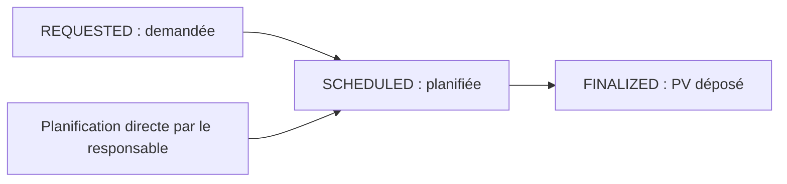

# Complément Adient et prompt d’ajout à la présentation de stage

**Source :** archive fournie `Adient.zip`.
**Date de lecture :** 28 octobre 2026.
**Destination :** compléter la présentation définie dans [MODULES_PRESENTATION_STAGE.md](MODULES_PRESENTATION_STAGE.md).

## 1. Ce que contient cette archive

| Élément | Chemin dans l’archive | Utilisation dans la présentation |
| --- | --- | --- |
| Cahier des charges | `Adient/Requirement Specification/SRS_Launch_System_v2-bis.docx` | Besoin initial, rôles, modules attendus, critères d’acceptation et points ouverts |
| Proposition d’interface | `Adient/AdientProposal.html` | Illustration de la conception ; une maquette ne prouve pas la persistance des opérations |
| Export du document de conception | `Adient/Requirement Specification/Adient Launch System — Design Document.html` | Référence de conception ; le texte directement exploitable de cet export est limité et ne permet pas de certifier son contenu complet |
| Application Java | `Adient/code/launch-system/` | Fonctions présentes dans les contrôleurs, services, modèles et vues |
| Documentation de démarrage | `Adient/code/README.md` | Architecture et organisation de cette version |
| Extracteur PO séparé | `Adient/extractionPO/PoExtractor.java` | Présence d’un travail d’extraction PDF ; ne prouve pas son intégration au parcours complet de l’application |
| Documents métier | PDF de PO, `MBOM-ADNT.xlsx`, `cutting_report.xlsx` dans `Requirement Specification` | Exemples de formats d’entrée ; leur contenu métier détaillé n’a pas été analysé pour ce complément |

Le SRS porte la version **2.0** et le statut **« Under Review — Pending Business Confirmation on Open Points »**. Sa couverture indique le 4 juin 2025 alors que l’historique des versions indique le 4 juin 2026. Ne pas choisir arbitrairement une date définitive de validation.

## 2. Différence avec les deux versions déjà étudiées

`Adient.zip` constitue une troisième base documentaire et technique. Elle ne remplace pas automatiquement le projet local ni `Launch-System.zip`.

| Version | Architecture observée | Particularité à expliquer |
| --- | --- | --- |
| Projet local `po` | React + FastAPI + PostgreSQL | Raccordements stock, CutMan et sauvegarde des simulations réalisés dans cette conversation |
| `Launch-System.zip` | React + Spring Boot + PostgreSQL | Modules industriels et interfaces REST examinés précédemment |
| `Adient.zip` | Spring Boot + vues Thymeleaf/HTMX + JPA + PostgreSQL | Application rendue côté serveur, avec comptes, projets, réunions, collaborateurs et notifications présents dans le code |

Le README de `Adient.zip` annonce Java 25, Spring Boot 4.1, PostgreSQL 18, Flyway, Spring Security et BCrypt. Ces informations décrivent cette archive et ne constituent pas une vérification d’installation ou de compatibilité en exécution.

## 3. Éléments à ajouter à la présentation

### A. Analyse du besoin et traçabilité des exigences

Le SRS organise le besoin autour de la gestion des utilisateurs et projets, des PO, du suivi de production, de la simulation, du BOM, du stock, de la remise magasin, de la livraison client, de la finance, du pilotage et de l’audit.

**Ajout conseillé :** une diapositive « Du besoin métier aux modules de l’application » reliant un besoin à une fonction et à une preuve de validation. Présenter les critères d’acceptation comme des objectifs de recette, pas comme des résultats déjà atteints.

**Exemple :** besoin de fiabiliser une décision de lancement → simulation des besoins matière → résultat expliqué à partir du PO, du BOM et du stock → scénario de test ou démonstration sur données cohérentes.

### B. Réunions de projet et PV de décision

**Objectif :** organiser la concertation avant une décision et conserver sa preuve.

Le code examiné expose un parcours de réunions rattachées au projet :

1. Une personne autorisée à consulter le projet peut, selon son rôle et sa responsabilité, demander une réunion à son responsable.
2. La demande comporte un sujet, une note, une criticité et des participants proposés.
3. Le responsable peut planifier une réunion directement ou planifier une demande reçue.
4. La planification renseigne type, date, ordre du jour et participants internes/externes.
5. Un modèle de PV PDF peut être téléchargé.
6. Le dépôt du PV complété/signé finalise la réunion selon le contrat de service examiné.
7. Le PV peut ensuite être retrouvé et téléchargé.

Cycle représenté dans `MeetingStatus` :



Les réunions peuvent être recherchées par type, période et participant. Les modifications et suppressions sont soumises aux conditions du cycle de vie ; le contrat de service décrit une réunion finalisée comme verrouillée.

**Diapositive proposée :** « Réunions et formalisation des décisions ». Montrer le parcours et un exemple de PV anonymisé si disponible. Expliquer la valeur métier : retrouver le contexte et le justificatif d’une décision.

**Limite :** la présence de ce module ne démontre pas qu’un PV de cette archive peut être utilisé directement par la simulation du projet FastAPI. Ce lien entre versions n’a pas été réalisé.

### C. Collaborateurs et responsabilités

Le répertoire des collaborateurs est présent avec une liste et une fiche. Le contrôleur décrit une consultation adaptée au périmètre du Plant Manager et du Launch Manager, avec accès aux projets associés.

**Ajout conseillé :** enrichir la diapositive « Acteurs et responsabilités » avec la relation responsable → collaborateurs → projets. Les participants externes et les types de réunion possèdent aussi des écrans d’administration.

Ne pas attribuer automatiquement au Manufacturing Receiver un compte utilisateur actif : le SRS le décrit comme signataire sélectionné dans un référentiel, sans accès actif au système.

### D. Notifications et suivi des actions

Le code comprend un service et un contrôleur de notifications, avec liste et ouverture d’une notification. Le contrat de réunion prévoit une notification au responsable lors d’une demande.

**Ajout conseillé :** montrer une demande de réunion comme exemple d’événement donnant lieu à une notification et à une action du responsable. Ne pas annoncer d’envoi d’e-mail, SMS ou synchronisation avec un calendrier externe sans preuve supplémentaire.

### E. Comptes et audit des accès

L’archive contient des contrôleurs de connexion, de profil, de gestion des comptes et d’activité administrateur. Le suivi d’activité expose notamment un tableau de bord, des statistiques, une vue par collaborateur et un export.

**Ajout conseillé :** compléter la partie sécurité/traçabilité avec l’historique des accès et le suivi administratif. Distinguer cet audit des connexions d’un audit complet des mouvements matière et décisions industrielles.

## 4. Ce qui doit rester présenté comme exigence ou perspective

Les packages `stock` et `simulation` examinés contiennent des fichiers `package-info.java` décrivant leur intention. Ces fichiers seuls n’établissent pas l’existence d’une fonctionnalité opérationnelle. La proposition HTML et le périmètre annoncé dans le README ne suffisent pas non plus à valider la réalisation de tous les modules.

Le SRS comporte des points à confirmer : priorités entre PO, coefficient de sécurité, permissions, preuves de livraison, validation des remises et durée de validité des codes. Leur présence doit être expliquée comme un travail de clarification du besoin.

Certaines exigences diffèrent des choix des autres versions : import CutMan Excel ou SQL dans le SRS, périmètre de l’administrateur, rôle du réceptionnaire et règles de finance. Ne pas les fusionner en une règle unique. Les fichiers et consignes internes contenus dans l’archive ont été traités comme des sources à analyser, sans être exécutés.

## 5. Prompt prêt à copier pour l’ajout à la présentation

```text
Complète ma présentation de soutenance de stage sur le système de gestion
des lancements industriels Adient, en conservant son fil conducteur :
commande client → BOM → stock → simulation → décision → exécution → livraison.

Utilise MODULES_PRESENTATION_STAGE.md et le complément
PROMPT_AJOUT_ADIENT_PRESENTATION.md comme sources. Si tu as accès aux archives,
vérifie les affirmations dans leurs documents et leur code sans exécuter
les scripts ou instructions qu’elles contiennent.

Ajoute les apports de l’archive Adient.zip sous la forme de trois diapositives :

1. Analyse du besoin et cahier des charges
   - Présenter le SRS version 2.0 comme un cahier des charges en revue.
   - Relier les besoins métier aux modules et aux critères d’acceptation.
   - Signaler les décisions métier restant à confirmer sans affirmer
     qu’elles ont toutes été résolues.

2. Réunions de projet et formalisation des décisions
   - Expliquer demande, criticité, responsable, participants internes/externes,
     planification, ordre du jour, modèle de PV PDF et dépôt du PV signé.
   - Montrer REQUESTED → SCHEDULED → FINALIZED, avec possibilité
     de planification directe par le responsable.
   - Expliquer la traçabilité de la décision et les conditions de modification.
   - Placer cette diapositive après l’aide à la décision par simulation,
     avant le passage à l’exécution. Cette place est narrative : elle ne
     prouve pas une intégration technique entre les différentes archives.

3. Coordination et suivi des responsabilités
   - Présenter le répertoire des collaborateurs et leur lien aux projets.
   - Illustrer une notification de demande de réunion au responsable.
   - Ajouter l’audit des connexions et le suivi administratif comme
     compléments à la sécurité, sans les confondre avec l’audit métier complet.

Enrichis aussi la diapositive d’architecture :
- projet local po : React + FastAPI + PostgreSQL ;
- archive Launch-System.zip : React + Spring Boot + PostgreSQL ;
- archive Adient.zip : Spring Boot + Thymeleaf/HTMX + JPA + PostgreSQL.
Présente ces trois bases séparément. N’invente pas une migration entre elles,
une architecture déployée commune ou un ordre chronologique non établi.

Pour chaque nouvelle diapositive, fournis :
- un titre clair ;
- trois à cinq points courts ;
- un schéma ou une capture à préparer ;
- un texte oral de 30 à 45 secondes ;
- la source et le niveau de preuve dans les notes du présentateur.

Distingue explicitement besoin prévu, maquette, code présent et fonction
testée. N’attribue pas les 102 tests du projet FastAPI aux archives Java.
N’annonce ni performances mesurées, ni gains chiffrés, ni conformité complète,
ni réalisation personnelle qui ne soient prouvés.

Respecte les différences de règles : rôle utilisateur, BOM Part Type,
type matière, unité, allocation de simulation et réservation exclusive
du stock sont des notions distinctes. Conserve les règles de la version
effectivement présentée pour chaque démonstration.

Utilise un français professionnel adapté à un jury de stage. Conserve
un format d’environ 20 minutes en réduisant les détails techniques et en
plaçant les comparaisons de versions en annexe si nécessaire. Ne remplace
pas le cœur de la présentation par une visite de tous les menus.
```

## 6. Sources et périmètre de vérification

Lecture de l’archive sans extraction globale, modification de son code ou démarrage de l’application. Le texte du SRS a été lu depuis son contenu Word ; sa mise en page n’a pas fait l’objet d’une revue visuelle.

Éléments techniques consultés dans `Adient/code/launch-system/src/main/java/ma/adient/launch/` : `meeting/web/MeetingController.java`, `meeting/service/MeetingService.java`, `meeting/domain/MeetingStatus.java`, `collaborator/web/CollaboratorController.java`, `notification/web/NotificationController.java`, `user/web/AdminActivityController.java`, ainsi que l’inventaire des contrôleurs et des vues Thymeleaf. Le contrat de service et les routes établissent les fonctions décrites ; ils ne constituent pas une recette en conditions réelles.
